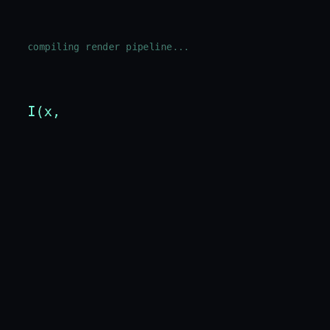

---

**Full-Stack AI Engineer · ML Systems & LLM Evaluation**  
B.Tech Electronics & Telecommunication Engineering · Class of 2026

AI-powered products · Agentic workflows · LLM evaluation · Distributed systems

---

### About Me

I'm a full-stack AI engineer who builds AI-powered products from idea to deployment. My work spans React and Next.js applications, API-backed AI workflows, LLM evaluation, privacy-focused product engineering, and distributed model training. I enjoy owning the full path — shaping a problem, designing the architecture, building the interface and backend, validating system behavior, and improving reliability.

I use **Claude Code, Cursor, OpenCode, and Z.ai agents** in my daily development workflow to accelerate implementation, debugging, and iteration.

- 💻 Worked as a **Software Engineer at Handshake**, contributing to Project Dynamo: terminal-based software-engineering tasks designed to evaluate AI agents on realistic, multi-step problems.
- 🔭 Worked as an **AI/ML Analyst at Outlier**, providing RLHF preference signals for 500+ model outputs and documenting recurring failure modes across code generation, reasoning, and instruction following.
- 🧪 Accepted as a **Research Intern at VLED Lab, IIT Ropar**.
- 🌍 Research collaborator at **MIT Critical Data**, under Dr. Leo Anthony Celi, M.D., M.S., M.P.H.
- 🛰️ Member of NASA Open Science Data Repository's **Analysis Working Group**, active in the AI/ML analysis working group.
- 🎓 Selected for the **YEL Summer Cohort 2026** from 2,000+ applicants across 73 countries; co-authored a paper on [Market-Based and Text-Based Measures of Investor Sentiment](https://docs.google.com/document/d/189rNpa-8U1hHyAMcR0VRJ94UAyuAdaGc/).

---

### Core Technologies

**Languages & Data** — Python · JavaScript · TypeScript · SQL · MySQL · SQLite

**Frontend** — React · Next.js · Vite · Tailwind CSS

**Backend & APIs** — FastAPI · Node.js runtime (Next.js API Routes) · Prisma ORM · Vercel Serverless Functions

**AI / LLM** — PyTorch · Hugging Face Transformers · LangChain · FAISS · Chroma · RLHF · LLM Evaluation · Prompt Engineering · NLP

**Distributed Systems & Infrastructure** — PyTorch DDP · NCCL · AMP · `torch.profiler` · AWS · GCP · Docker · Vercel · Git

**AI-Assisted Development** — Claude Code · Cursor · OpenCode · Z.ai agents

---

### Featured Work

#### 1. [AI Passport Consent Audit](https://github.com/JyotiS34/AI-Passport-Consent-Audit) · [Live Demo](https://ai-passport-consent-audit.vercel.app/)

**Problem:** A bulk "approve all" consent flow can expose substantially more personal data than a user intends to share.  
**Build:** Independently audited the consent flow and built a Next.js + React application using Vercel serverless functions. Designed a real-time exposure score to show how much data a consent action would reveal before confirmation.  
**Engineering focus:** Privacy-aware product design, consent UX, serverless application architecture, and iterative validation across multiple consent-interface prototypes.

**High-level flow:** Consent selection → exposure assessment → user reviews the data impact → informed confirmation.

#### 2. [Aurora — Full-Stack AI Sentiment Application](https://github.com/JyotiS34/Aurora-Webapp) · [Live Demo](https://aurora-webapp.vercel.app/)

Fine-tuned `bert-base-uncased` for review sentiment classification and built the surrounding product: a FastAPI inference backend and a React/Vite frontend. Deployed the interface on Vercel and the model service on Hugging Face Spaces. The application includes live inference with confidence scores, a training walkthrough, a DDP pipeline visualisation, and a failure-mode explorer. Evaluated per-class precision, recall, and F1, and investigated loss spikes, input-length effects, and class imbalance.

#### 3. [Aabir — AI Customer-Support Agent](https://github.com/JyotiS34/aabir-support-agent) · [Live Demo](https://aabir-support-agent.vercel.app/)

Built a full-stack support-agent prototype with **Next.js App Router, TypeScript, Prisma, and SQLite**. Its server-side workflow combines Groq-hosted `openai/gpt-oss-120b` calls with a fine-tuned BERT sentiment model to classify customer intent, assess sentiment, draft replies grounded in resolution patterns, and choose between automated handling and human escalation. Created an evaluation set of 175 examples — 120 real `@AmazonHelp` customer messages and 55 cross-domain Banking77 examples — to compare baselines, inspect failure modes, and evaluate the agent's decisions. The escalation strategy combines deterministic safety signals with LLM judgment.

#### 4. [Inference Timing Ledger](https://github.com/JyotiS34/Inference-Timing-Ledger)

Designed a **36-column CSV schema** for recording reproducible LLM inference measurements, covering model and device provenance, precision, workload configuration, warmup and synchronization methodology, latency percentiles, throughput, peak memory, and software versions. Built a dependency-free Python 3.8+ CLI validator with **20 error checks and 17 warning checks**, strict mode, machine-readable JSON reports, and GitHub Actions CI. Deliberately malformed fixtures exercise validation behavior. The included benchmark rows are synthetic examples, but are ready to swap with measured model-performance data.

#### 5. [Multi-GPU DDP Training Deep Dive](https://www.kaggle.com/code/jyotirmoy32/transformer-training-on-2-t4-ddp-deep-dive)

Built a 10M-parameter Transformer classifier from scratch and trained it with PyTorch `DistributedDataParallel` across 2× NVIDIA T4 GPUs, measuring a **2.03× throughput speedup** over the single-GPU baseline. Used `torch.profiler` and repeatable experiments to diagnose and fix three distributed-training failure modes: gradient explosion, CUDA out-of-memory errors, and incorrect data shuffling.

#### 6. [AeroSim6 — 6-DOF Drone Flight Simulator](https://github.com/JyotiS34/AeroSim6)

Solo-built a 6-degree-of-freedom drone flight simulator in Panda3D with inertia-based dynamics, frame-rate-independent delta-time physics, WASD/Q/E controls, and traversal-based collision detection. Kept flight dynamics, input handling, and scene management in separate modules to make the system easier to extend and debug.

---

### Resume

<a href="https://drive.google.com/file/d/1hq-71LTVwyouTvRrXsYdosKXbxQxEwWq/view?usp=drivesdk"
   class="download-resume">
  Download Resume
</a>

### Achievements & Research

- 🏆 **YEL Summer Cohort 2026** — selected from 2,000+ applicants across 73 countries.
- 🔬 **Research Intern, VLED Lab, IIT Ropar** — accepted for a research internship.
- 🏥 **MIT Critical Data** — research under Dr. Leo Anthony Celi.
- 🛰️ **NASA Open Science Data Repository** — member of the AI/ML Analysis Working Group.
- 🎖️ **NEC Merit Scholarship** recipient.
- ✅ Qualified on-campus placement interviews at ORC Engineering and ELEATION.

---

© 2026 · All Rights Reserved
